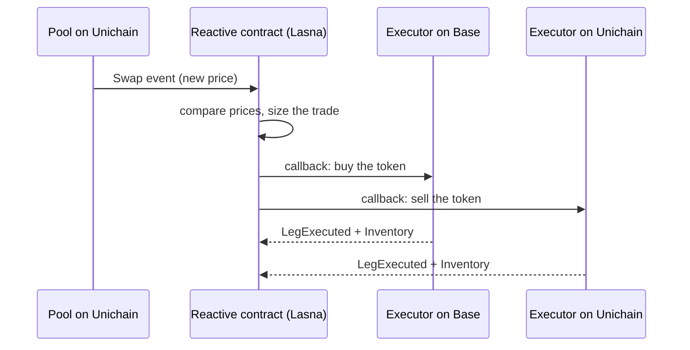

# SpreadHunter

SpreadHunter is an arbitrage bot that lives on-chain: when the same token costs less on one chain than on another, it buys where it is cheap and sells where it is dear, on both chains in the same couple of seconds. It runs on Base and Unichain, and a reactive contract on [Reactive Network](https://dev.reactive.network/) does the watching, so no server of yours has to stay online.

Built for the Reactive Omni Buildathon (track "Every Second Counts").

## The problem

Prices of the same pair drift apart across chains all the time: someone makes a big buy on one chain and, for a few seconds, the token is dearer there. Catching that gap usually means running a bot that watches every pool around the clock and signs trades on two chains at once. SpreadHunter keeps an inventory of USDC and the token on each chain, and a contract on Reactive Network watches both pools and fires both trades the moment the gap pays for its fees. The trades come out of the inventory already on each chain, so no bridge sits in the way and nothing waits for a transfer.

## See it working

This cycle ran on testnet on 2026-11-19, against two USDC/HUNT pools (HUNT is a test token: testnets have no pools with real liquidity). Every value below is read from the chain.

| Step | Chain | Time after the swap | Transaction |
|---|---|---|---|
| Someone buys HUNT with 20 USDC: HUNT is now about 10% dearer on Unichain | Unichain Sepolia | 0 s | [0xfa6cb57d…](https://sepolia.uniscan.xyz/tx/0xfa6cb57de334921d50bdda7c10e190376cf6600bf4a31c59368f08250a4e97b2) |
| The reactive contract sizes the trade and asks for both legs | Reactive Lasna | within the second* | [0x5930979b…](https://lasna.reactscan.net/tx/0x5930979bf0d29c8ed07262be278df1ac77122f2ce9d3fb8b83ed4b907f21c64a) |
| Buys 937.4022 HUNT for 9.608635 USDC | Base Sepolia | 1 s | [0xd87c7be4…](https://sepolia.basescan.org/tx/0xd87c7be443e98af70aac8cf0ece0094f8ebb6ac0b76f3c4dc89b6d64c7def20c) |
| Sells 937.4023 HUNT for 10.081263 USDC | Unichain Sepolia | 2 s | [0xa7a13b48…](https://sepolia.uniscan.xyz/tx/0xa7a13b48f516ab4e313f07356897ed106c9ad1f216686265f2093ac27f17933e) |

The profit was 0.472628 USDC, the same amount the reactive contract worked out before sending the legs, and the HUNT held across both chains stayed the same apart from rounding dust (0.0000673 HUNT, bought 937.402221914 and sold 937.402289257). Times come from block timestamps, which have a resolution of one second. *Lasna's block carries a timestamp one second earlier than the Unichain swap, because the two chains' clocks are about a second apart. Each leg used about 200 000 gas on its chain.

Deployed contracts:

| Contract | Chain | Address |
|---|---|---|
| SpreadHunterReactive | Reactive Lasna | [`0xA07fcfCbE127D14668Ffb93f41aFF270b151777F`](https://lasna.reactscan.net/address/0xA07fcfCbE127D14668Ffb93f41aFF270b151777F) |
| Executor | Base Sepolia | [`0x63d0c088C404E5800CA21BFffDd39Db273Cdd500`](https://sepolia.basescan.org/address/0x63d0c088C404E5800CA21BFffDd39Db273Cdd500) |
| Executor | Unichain Sepolia | [`0x5Ae2db5f67D73749a4D06229e851CAEd21F37753`](https://sepolia.uniscan.xyz/address/0x5Ae2db5f67D73749a4D06229e851CAEd21F37753) |

## How it works

1. Each chain has an **Executor** that holds the owner's USDC and token and can trade on one Uniswap V4 pool of that pair.
2. The **reactive contract** on Reactive Network subscribes to the swaps of both pools and to the Executors' balances.
3. When a swap moves one pool's price, it compares both prices, finds the trade size that makes the most USDC after the fees of both pools, and cuts it to the owner's cap and to the inventory on each side.
4. If the expected profit beats the owner's minimum, it asks for two callbacks in the same reaction: buy on the cheap chain, sell the same amount on the dear one.
5. Each Executor trades with a minimum output and a price limit, then reports its balances, and the reactive contract waits for both results before it trades again.



The size comes from the two pools' reserves, then the owner's limits and the inventory cut it down:

```solidity
p.usdcIn = ArbMath.optimalUsdcIn(p.usdcA, p.tokenA, feeA, p.usdcB, p.tokenB, feeB);
if (p.usdcIn > params.maxTradeUsdc) p.usdcIn = params.maxTradeUsdc;
if (p.usdcIn > _sides[p.a].usdc) p.usdcIn = _sides[p.a].usdc;
```

`contracts/src/reactive/SpreadHunterReactive.sol`: the contract never spends more than the owner allowed per trade, nor more USDC than the cheap chain holds. The formula itself is in `contracts/src/reactive/ArbMath.sol`; its fuzz tests check that no nearby trade size makes more.

A leg that cannot run reports its failure instead of reverting the callback:

```solidity
try this.swapExactIn(buyToken, amountIn, minAmountOut, sqrtPriceLimitX96) returns (
    uint256 paid, uint256 received
) {
    executed = true;
    // (two comment lines omitted)
    emit LegExecuted(legId, buyToken, paid, received);
} catch (bytes memory err) {
    reason = err;
}
```

`contracts/src/executor/Executor.sol`: if the price moved, the deadline passed or the balance is short, the Executor reports `LegFailed` and moves no funds, so the reactive contract learns how each leg ended. The one exception is a callback sent with too little gas to emit these events: then the whole callback reverts, and the reactive contract releases the trade after its deadline. Paid and received are measured as the Executor's own balance changes, so a token that skims transfers cannot pass the minimum.

Failures have a brake:

```solidity
cooldownUntil = block.timestamp + FAILURE_COOLDOWN;
if (++failuresInARow >= MAX_FAILURES_IN_A_ROW) {
    paused = true;
    emit AutoPaused(failuresInARow);
}
```

`contracts/src/reactive/SpreadHunterReactive.sol`: after a trade with a failed leg the contract waits 60 seconds, and after three failed trades in a row it pauses until the owner resumes it. Only a swap made by someone else can start a trade, so a state that keeps failing cannot loop.

What the owner controls, and the hard limits in the code: minimum profit, maximum trade (at most 1 000 000 USDC), slippage per leg (0.01% to 5%), leg deadline (5 to 600 seconds) and callback gas (300 000 to 900 000). Only the owner can withdraw, and only to the owner's address.

Limits worth knowing:

- Inventory stays on each chain. A run of gaps in the same direction moves USDC to one chain and the token to the other, and the bot stops trading that way until a gap in the other direction brings it back.
- The size is exact on full-range pools. On pools with concentrated liquidity it is an approximation, and the minimum output and price limit make a leg fail rather than lose.
- The legs are visible on Reactive Network a few seconds before they run, so someone could trade ahead of a leg up to its slippage limit.
- The Executor accepts hookless, fixed-fee Uniswap V4 pools of USDC against an ERC-20 token.

## Quick start

Requirements: [Git](https://git-scm.com/downloads), [Foundry](https://www.getfoundry.sh/introduction/installation) v1.9.0 and a bash shell (on Windows, Git Bash). [Halmos](https://github.com/a16z/halmos) is optional, for the symbolic property in `contracts/test/halmos/`.

```bash
git clone --recurse-submodules https://github.com/JaDi03/Spread-Hunter.git
cd Spread-Hunter/contracts
forge build
forge test
```

If you cloned without `--recurse-submodules`, run `git submodule update --init --recursive` inside `Spread-Hunter` first. On Windows, run `git config --global core.longpaths true` before cloning, and clone into a folder with a short path (for example `C:\code`). The deepest nested submodules of Uniswap's libraries fail to clone (`Filename too long` or `'$GIT_DIR' too big`) when the parent folder's path is already long.

The tests run the Executor against Uniswap's real PoolManager, compiled locally, and run the whole loop with two pools, two Executors and the reactive contract.

## Live dashboard

`web/` is a page that reads both pools and the reactive contract straight from the public RPCs, with no backend: the HUNT price on each chain, the spread against the two pool fees, each side's inventory as the reactive contract last saw it, and a map of the cycle. New swaps and trades show up on the map while the page is open; when none is happening, it replays the cycle above with its real transactions, and says so. It needs [Node](https://nodejs.org/) 24 and [pnpm](https://pnpm.io/installation):

```bash
cd web
pnpm install
pnpm dev
```

Addresses and RPC URLs live in `web/src/config/testnet.ts`.

To measure the latency of every trade the reactive contract has made, from the swap that started it to both legs, run `pnpm latency` in `web/`. It reads the three chains, prints one row per trade with a summary, and writes `web/src/data/latency.json`, which the dashboard shows. Times are differences of whole-second block timestamps, so each one is accurate to about a second. Lasna's block clock can read behind Base and Unichain (in the first trade, Lasna stamped its request a second before the swap that caused it), so Lasna times are only compared with other Lasna times.

## Deploy a pair

The pair, its pools, the trading parameters, the inventory and the funding all live in one file, [`contracts/script/config/DemoPair.sol`](contracts/script/config/DemoPair.sol); network addresses (USDC, PoolManager, callback proxies) live in [`contracts/script/config/Testnet.sol`](contracts/script/config/Testnet.sol). The values in the repo are the demo pair above. To run your own pair, point `DemoPair.sol` at a token that has a hookless, fixed-fee Uniswap V4 pool against USDC with liquidity on both chains, and set your own amounts. This repo does not create tokens or pools: the pair has to exist already.

The demo values need, per chain: 0.005 ETH for each Executor's callbacks, 100 USDC and 10 000 tokens of inventory, plus 5 lREACT for the reactive contract on Lasna and gas on each chain.

You need a wallet used only for testnets, with:

- ETH on Base Sepolia and Unichain Sepolia;
- lREACT on Reactive Lasna. Send Base Sepolia or Ethereum Sepolia ETH to the Reactive faucet contract and it sends lREACT back. The [Reactive docs](https://dev.reactive.network/reactive-mainnet) give a rate of 1 ETH for 100 lREACT and a maximum of 5 ETH per transaction (anything above is lost); a 0.02 ETH test from Base Sepolia on 2026-11-19 returned 6 lREACT;
- testnet USDC on both chains from the [Circle faucet](https://faucet.circle.com) and the token of your pair on both chains.

| Pay from | Faucet contract |
|---|---|
| Ethereum Sepolia | `0x9b9BB25f1A81078C544C829c5EB7822d747Cf434` |
| Base Sepolia | `0x2afaFD298b23b62760711756088F75B7409f5967` |

The scripts sign with a [Foundry keystore](https://www.getfoundry.sh/cast/reference/wallet), so the private key never sits in a plain file. Import the wallet once (it asks for the key and a password), then load `.env` from the repository root:

```bash
cast wallet import spreadhunter-deployer --interactive
cp .env.example .env            # then set DEPLOYER_ADDRESS
cd contracts
set -a; source ../.env; set +a
: "${DEPLOYER_ACCOUNT:?set it in .env}" "${DEPLOYER_ADDRESS:?set it in .env}"

P=script/PairDeploy.s.sol:PairDeploy
W="--account $DEPLOYER_ACCOUNT --sender $DEPLOYER_ADDRESS"

# 1. Reactive contract on Lasna. It goes first: the Executors need its address
forge script $P --sig "reactive()" --rpc-url lasna $W --broadcast
# 2. One Executor per chain
forge script $P --sig "executor(address)" <REACTIVE> --rpc-url base_sepolia $W --broadcast
forge script $P --sig "executor(address)" <REACTIVE> --rpc-url unichain_sepolia $W --broadcast
# 3. Link both Executors to the reactive contract
forge script $P --sig "link(address,address,address)" <REACTIVE> <BASE_EXECUTOR> <UNICHAIN_EXECUTOR> --rpc-url lasna $W --broadcast
# 4. Move the inventory into each Executor
forge script $P --sig "fund(address)" <BASE_EXECUTOR> --rpc-url base_sepolia $W --broadcast
forge script $P --sig "fund(address)" <UNICHAIN_EXECUTOR> --rpc-url unichain_sepolia $W --broadcast
```

Run each line once without `--broadcast` first: it simulates against the live chain. Each step prints the address the next one needs. Before step 3, check that each Executor points at the reactive contract and at its pool:

```bash
cast call <BASE_EXECUTOR> "_CALLBACK_SENDER()(address)" --rpc-url base_sepolia
cast call <BASE_EXECUTOR> "poolId()(bytes32)" --rpc-url base_sepolia
```

After step 4, the reactive contract should know both inventories (`stocked` is the fifth field). If one is `false`, call `sync()` on that Executor from the owner account:

```bash
cast call <REACTIVE> "sideState(uint256)((uint160,uint128,uint24,bool,bool,uint256,uint256,uint256,uint256))" 0 --rpc-url lasna
```

The reactive contract starts trading once it has seen a swap on each pool. Any swap works; with Uniswap's [`PoolSwapTest`](https://github.com/Uniswap/v4-core/blob/main/src/test/PoolSwapTest.sol) router (Base Sepolia `0x8B5bcC363ddE2614281aD875bad385E0A785D3B9`, Unichain Sepolia `0x9140a78c1A137c7fF1c151EC8231272aF78a99A4`, from [Uniswap's deployments list](https://developers.uniswap.org/deployments.json)), approve the input token to the router and call:

```bash
# exact input of <AMOUNT_IN> units of currency0 (zeroForOne = true); 4295128740 is the lowest allowed price limit
cast send <SWAP_TEST> "swap((address,address,uint24,int24,address),(bool,int256,uint160),(bool,bool),bytes)" \
  "(<CURRENCY0>,<CURRENCY1>,<FEE>,<TICK_SPACING>,0x0000000000000000000000000000000000000000)" \
  "(true,-<AMOUNT_IN>,4295128740)" "(false,false)" 0x --rpc-url base_sepolia --account $DEPLOYER_ACCOUNT
```

## Reactive loop test

`contracts/src/spike/` holds the first test of the reactive loop: a `Ping` on Base Sepolia makes a reactive contract on Lasna send a callback back to Base Sepolia, which emits `Pong`. It runs with [`contracts/script/SpikeDeploy.s.sol`](contracts/script/SpikeDeploy.s.sol), with `W` set as above:

```bash
S=script/SpikeDeploy.s.sol:SpikeDeploy
forge script $S --sig "emitter()" --rpc-url base_sepolia $W --broadcast
forge script $S --sig "reactive(address,uint256,uint256)" <EMITTER> 10 <FUNDING> --rpc-url lasna $W --broadcast
forge script $S --sig "callback(address,uint256)" <REACTIVE> <FUNDING> --rpc-url base_sepolia $W --broadcast
forge script $S --sig "link(address,address)" <REACTIVE> <CALLBACK> --rpc-url lasna $W --broadcast
forge script $S --sig "ping(address,uint256)" <EMITTER> 42 --rpc-url base_sepolia $W --broadcast
cast call <CALLBACK> "pongCount()(uint256)" --rpc-url base_sepolia
```

Funding amounts are in wei.

## Project structure

```
contracts/
├── src/executor/     Executor: one owner's inventory and one pool per chain
├── src/reactive/     reactive contract and the arbitrage math
├── src/spike/        first test of the reactive loop
├── script/           deploy scripts; config/ holds network addresses and the pair
├── test/             unit, fuzz and full-loop tests; halmos/ holds symbolic properties
└── lib/              dependencies as git submodules
web/
├── src/chain/        reads the pools and the reactive contract (viem)
├── src/components/   price panel, cycle map, event tape, chart, inventory
└── src/config/       network addresses and RPC URLs
```

## Tech stack

- **[Reactive Network](https://dev.reactive.network/)**: the reactive contract that watches both pools and sends the callbacks ([reactive-lib-omni](https://github.com/Reactive-Network/reactive-lib-omni)).
- **[Uniswap V4](https://github.com/Uniswap/v4-core)**: the pools the Executors trade on ([v4-periphery](https://github.com/Uniswap/v4-periphery) as a submodule).
- **[Foundry](https://www.getfoundry.sh/)**: build, tests and deploy scripts.
- **[OpenZeppelin Contracts](https://github.com/OpenZeppelin/openzeppelin-contracts)**: safe token transfers and math.
- **[Vite](https://vite.dev/), [React](https://react.dev/) and [viem](https://viem.sh/)**: the live dashboard.
- **[Circle USDC](https://developers.circle.com/stablecoins/usdc-contract-addresses)**: the quote token on both chains.

## License

MIT, see [LICENSE](LICENSE).
